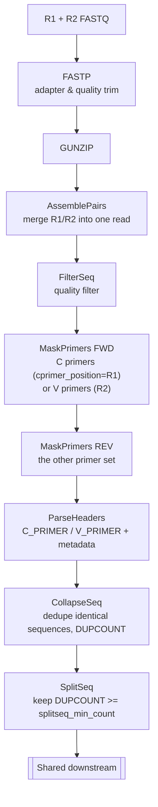
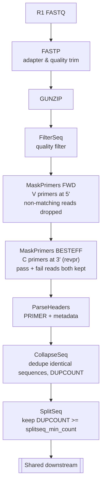
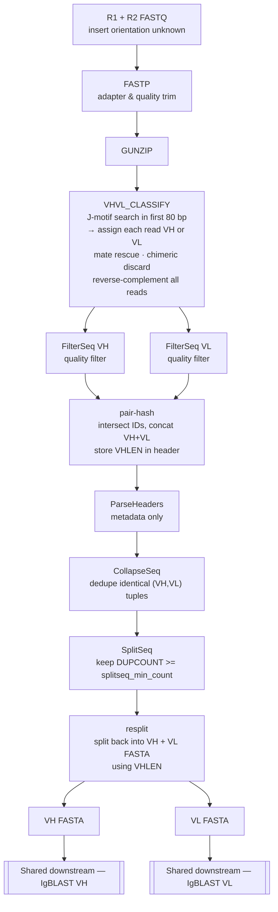
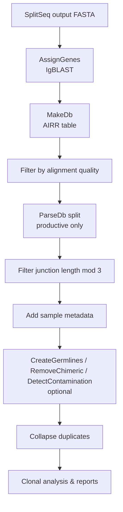

# airrflow -- AlloVista fork

Custom fork of [nf-core/airrflow](https://github.com/nf-core/airrflow) for the AlloVista platform.

For full pipeline documentation, usage, and parameter reference see the upstream repo: <https://nf-co.re/airrflow>

## Run modes: paired-end and single-end

The library layout is selected with `--single_end` (default `false`) and `--library_generation_method`. The modes differ only in pRESTO pre-processing. From VDJ annotation onward they are identical.

| | Paired-end (default) | Single-end (`--single_end true`) | VH:VL (`--library_generation_method vhvl`) |
|---|---|---|---|
| Input | R1 + R2 FASTQ | R1 FASTQ only | R1 (VH) + R2 (VL) FASTQ |
| Read assembly | `AssemblePairs` merges R1/R2 | none | none (chains are independent) |
| Primer masking | C and V both required (order set by `--cprimer_position`) | V required (5'); C **best-effort** (3', reads kept even without a match) | **skipped** (no primers) |
| Collapse | per-sequence | per-sequence | **pair-level** — VH+VL concatenated before CollapseSeq |
| ParseHeaders | `C_PRIMER` + `V_PRIMER` | single `PRIMER` field | metadata only |
| Output | single FASTA | single FASTA | two FASTAs (VH + VL), separate IgBLAST |

The diagrams show the sans-UMI path (`library_generation_method = specific_pcr`). With UMIs, both modes add barcode extraction and `BuildConsensus` before primer masking. Paired-end UMI also adds `PairSeq` and `ClusterSets`.

### Paired-end



### Single-end



### VH:VL paired



### Shared downstream (all modes)



## Customizations

- **VH:VL paired sequencing** -- `--library_generation_method vhvl` for OE-RT-PCR linked VH:VL data (e.g. DeKosky method). Insert orientation is random, so a J-motif classifier (`VHVL_CLASSIFY`) assigns each read to VH or VL before quality filtering. FilterSeq runs on each chain independently, then pair-hash concatenates VH+VL for pair-level CollapseSeq (preserving biological pairing). After SplitSeq, resplit produces separate VH and VL FASTAs for independent IgBLAST. Paired sequences share the same `sequence_id` for downstream joining. See [Chain classification](#chain-classification) below.

- **Single-end support** -- `--single_end` runs a pRESTO branch without pair assembly, with best-effort 3' C-primer masking so reads that miss the C primer are kept.

- **AWS Batch (Fargate) execution profile** -- `aws_batch` and `local` config profiles for Fargate Spot with automatic retries, Wave-augmented containers, and Seqera Platform integration.
- **UMI auto-detect mode (`umi_length = -1`)** -- bypasses explicit UMI offset arithmetic when the offset is already embedded in the primer start position, while still running the full UMI consensus workflow.
- **Barcode truncation step** -- new `PRESTO_TRUNCATE_BARCODE` process trims BARCODE annotations to the declared UMI length after MaskPrimers align, removing stagger contamination before consensus building.
- **Primer field naming** -- MaskPrimers annotates both forward and reverse primer hits under the unified field `PRIMER` (was `FWD_PRIMER` / `REV_PRIMER`).
- **Configurable SplitSeq minimum count** -- the duplicate/consensus count threshold is exposed as `--splitseq_min_count` (default 2).
- **CHANGEO_ASSIGNGENES resource boost** -- IgBLAST gene assignment gets dedicated resources (4 CPUs, 16 GB) and retry-on-failure.
- **`specific_pcr` library method fix** -- correctly passes `umi_length = 0` downstream when `library_generation_method` is `specific_pcr`.

## Chain classification

The `VHVL_CLASSIFY` process (`bin/classify_paired_reads.py`) assigns each read in a pair to a chain (VH or VL) by searching for J-gene motifs in the first 80 bp of the antisense read. This is necessary for emulsion-linked paired-chain data (OE-RT-PCR) where insert orientation is random — R1 is not necessarily VH.

### Algorithm

1. **Motif search** — scan the first 80 bp of each read for J-segment motifs defined in a FASTA file. Each motif is tagged with a chain label (VH, VL, TRA, TRB, etc.).
2. **Classification** — the chain with the most motif hits wins. Ties go to the first chain in the motif file.
3. **Mate rescue** — if one read is classified and the other is not (`?`), the unclassified read is assigned to the opposite chain.
4. **Chimeric discard** — if both reads classify to the same chain, the pair is discarded.
5. **Unclassified discard** — if neither read matches any motif, the pair is discarded.
6. **Reverse-complement** — all classified reads are reverse-complemented (sequence and quality) before output.

### Motif FASTA format

Motif files live in `assets/motifs/`. Each entry's header line has the format:

```
>CHAIN MOTIF_NAME [optional description] [~]
SEQUENCE_OR_REGEX
```

- **First word** = chain label (`VH`, `VL`, `TRA`, `TRB`, etc.)
- **Trailing `~`** on the header = the sequence line is a regex (Python `re` syntax); otherwise it's a literal substring match
- Multiple motifs per chain are allowed; more motifs = more sensitive classification

Example (`assets/motifs/vhvl.fasta`):

```fasta
>VH JH_FR4_core antisense
GACGGTGACC
>VH JH_WGQG_CG antisense
CGCCCCA
>VH JH_WGQG_GG antisense
GGCCCCA
>VL JL_lambda_FR4_core antisense
GACAGTGACC
>VL JL_FGXG antisense ~
CC[TC]TG[ACGT]CC[AG][AG]A
```

### Outputs

- `{sample}_VH.fastq` / `{sample}_VL.fastq` — classified, reverse-complemented reads
- `{sample}_classify_stats.tsv` — per-category read counts (VH, VL, chimeric, unclassified)
- `{sample}_classify.log` — stderr log

### Adding new library types

To support a new paired-chain type (e.g. TCR TRA/TRB):

1. Create a motif FASTA in `assets/motifs/` with the appropriate chain labels and J-motifs
2. The classifier auto-detects the two chain labels from the file
3. Wire the motif file into the pipeline via `sequence_assembly.nf` (currently hardcoded to `vhvl.fasta` for the `vhvl` library method)
