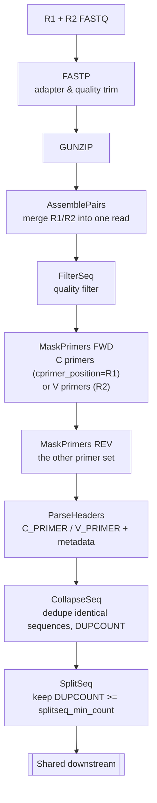
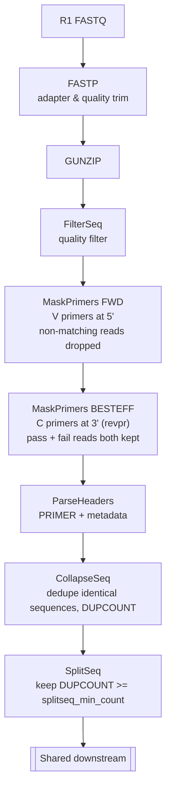
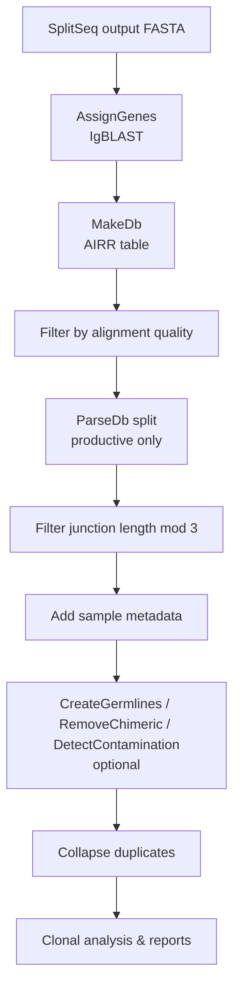

# airrflow -- AlloVista fork

Custom fork of [nf-core/airrflow](https://github.com/nf-core/airrflow) for the AlloVista platform.

For full pipeline documentation, usage, and parameter reference see the upstream repo: <https://nf-co.re/airrflow>

## Run modes: paired-end and single-end

The library layout is selected with `--single_end` (default `false`). The two modes differ only in the pRESTO pre-processing. From VDJ annotation onward they are identical.

| | Paired-end (default) | Single-end (`--single_end true`) |
|---|---|---|
| Input | R1 + R2 FASTQ | R1 FASTQ only |
| Read assembly | `AssemblePairs` merges R1/R2 | none |
| Primer masking | C and V both required (order set by `--cprimer_position`) | V required (5'); C **best-effort** (3', reads kept even without a match) |
| ParseHeaders | `C_PRIMER` + `V_PRIMER` | single `PRIMER` field |

The diagrams show the sans-UMI path (`library_generation_method = specific_pcr`). With UMIs, both modes add barcode extraction and `BuildConsensus` before primer masking. Paired-end UMI also adds `PairSeq` and `ClusterSets`.

### Paired-end

### Single-end

### Shared downstream (both modes)

## Customizations

- **Single-end support** -- `--single_end` runs a pRESTO branch without pair assembly, with best-effort 3' C-primer masking so reads that miss the C primer are kept.

- **AWS Batch (Fargate) execution profile** -- `aws_batch` and `local` config profiles for Fargate Spot with automatic retries, Wave-augmented containers, and Seqera Platform integration.
- **UMI auto-detect mode (`umi_length = -1`)** -- bypasses explicit UMI offset arithmetic when the offset is already embedded in the primer start position, while still running the full UMI consensus workflow.
- **Barcode truncation step** -- new `PRESTO_TRUNCATE_BARCODE` process trims BARCODE annotations to the declared UMI length after MaskPrimers align, removing stagger contamination before consensus building.
- **Primer field naming** -- MaskPrimers annotates both forward and reverse primer hits under the unified field `PRIMER` (was `FWD_PRIMER` / `REV_PRIMER`).
- **Configurable SplitSeq minimum count** -- the duplicate/consensus count threshold is exposed as `--splitseq_min_count` (default 2).
- **CHANGEO_ASSIGNGENES resource boost** -- IgBLAST gene assignment gets dedicated resources (4 CPUs, 16 GB) and retry-on-failure.
- **`specific_pcr` library method fix** -- correctly passes `umi_length = 0` downstream when `library_generation_method` is `specific_pcr`.
